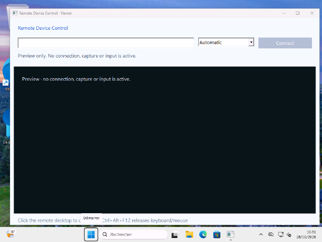

# Remote Device Control — Windows Remote Desktop with Vdevice Input

Control an authorized Windows PC using a **portable C++ viewer** and a **single-file host installer**. Screen updates and keyboard/mouse input use separate, authenticated, encrypted channels. The host creates a real virtual USB keyboard and absolute mouse with **[Vdevice](https://github.com/TitanCSA/Vdevice)**.

**[Download](https://github.com/TitanCSA/Remote-Device-Control/releases/latest)** · [How it works](docs/ARCHITECTURE.md) · [Tests and limits](docs/VALIDATION.md)



## Connect

On the **target PC**:

1. Run **RemoteDeviceControlSetup.exe**, accept elevation and choose **Install / repair**. This installs the Vdevice demo and one automatic remote-host service. Keep **Internet relay** enabled for connections through a router.
2. Restart only if requested. Sign in to Windows and keep the desktop unlocked.
3. Choose **Copy connection code** and share it privately with the intended controller.

On the **controlling PC**:

1. Run **RemoteDeviceControl.exe**. No installation, driver or administrator rights are required here.
2. Paste the connection code and choose **Connect**. Automatic mode tries direct LAN first, then the HTTPS relay.
3. Click the remote desktop to control it. **Ctrl+Alt+F12** releases keyboard capture; **F11** toggles full screen. Disconnect releases held input and removes the session's virtual devices.

The connection code grants access to the signed-in desktop. Treat it like a password. The target displays a tray indicator during sharing, with a **Disconnect** command. The installed service starts with Windows; capture and virtual input begin only after authentication.

## LAN and Internet

- **LAN direct:** IPv4 TCP port **48761**. Setup adds one executable-scoped rule for the **Private** Windows network profile and local subnet. It does not change your network profile, router or security settings. On an untrusted/public network use Internet relay instead.
- **Internet relay:** outbound HTTPS/WebSocket connections through `licences.configcsa.com`. No router port forwarding is required. A separate pinned TLS session runs end to end, so the relay forwards ciphertext without the host's private key or pairing secret.
- The public relay has bounded admission, session lifetime and bandwidth. It is a best-effort service; Internet distance, congestion and firewalls still affect latency and availability. Relay source is included for self-hosting.

## Vdevice demo

The included, unchanged **Microsoft-signed Vdevice 1.0.5.0 demo** has **one hour per Windows kernel boot**, shared with other Vdevice applications. The allowance starts when a virtual device is first created, rather than when the host service starts. Closing or reinstalling does not reset it. Expiry ends control; use Windows **Restart** for a new allowance.

The viewer displays the remaining allowance and input acknowledgement roundtrip. An acknowledgement means the host accepted input reports; it does **not** measure the time a game, application or display takes to react.

## Remove the host

Open the host installer or **Windows Settings → Apps → Remote Device Control**, then choose **Uninstall**. It removes this project's service, firewall rule, configuration, registration and owned application files.

Vdevice that was already installed is preserved. When this installer originally installed Vdevice, the removal UI offers a separate driver checkbox: leave it unchecked if other applications now need the shared driver. Windows may require a restart for the resident demo clock or Driver Store cleanup. If package removal is deferred, setup explains the remaining step; it retains only the removal tools needed to finish after restart. Unexpected files are retained and reported.

Windows' own event, security and SetupAPI records are preserved. This project does not attempt to erase audit history or promise an untraceable uninstall.

## Performance and scope

Capture uses persistent **DXGI Desktop Duplication** resources with an explicit GDI compatibility fallback. Frames are independently encoded with **WIC JPEG** and presented through **Direct2D**. Only the latest waiting frame is retained; slow video does not queue keyboard input behind images. Pointer motion may be coalesced while key/button transitions remain ordered and bounded.

This version uses **CPU JPEG, not hardware H.264**. Display refresh, encoding, bandwidth and Windows scheduling determine the actual frame rate and delay. It does not promise zero latency or compatibility with every graphics stack.

Windows 10 2004+ / Windows 11 **x64**, primary monitor, at most 1920×1080. Control targets the active, signed-in console desktop. Locked/logged-out, UAC secure desktops and unrelated RDP sessions are not shared; reconnect after returning to an available desktop. Audio, clipboard synchronization, file transfer and a custom Ctrl+Alt+Delete command are not implemented. The viewer refuses a connection to its own installed host to prevent an input feedback loop.

## Build

Use Visual Studio 2022 Desktop C++, a Windows SDK, CMake and .NET Framework already supplied by the supported Windows installation for the upstream Vdevice setup:

```powershell
.\Build.ps1 -VdeviceSetup C:\Downloads\VdeviceSetupConsole.exe
```

Supply the matching **1.0.5.0** console setup from the [Vdevice release](https://github.com/TitanCSA/Vdevice/releases). The host installer embeds it unchanged. Native application builds use the static MSVC runtime. `-TestsOnly` builds offline protocol/input/image tests; no setup, capture, service or input operation is performed by these tests.

The C++ application, viewer, installer, raw two-file Vdevice SDK and relay source are included. **Kernel source and signing material are excluded.** Microsoft signing covers the upstream kernel package, not the newly built application EXEs.

Source is MIT; original acknowledgements are retained under `licenses/`. Vdevice binaries have their own distribution/demo terms. Use only on systems whose owner has authorized remote access, in compliance with applicable laws and service rules. The software is provided as-is; its authors do not accept responsibility for unlawful or unauthorized use, to the extent permitted by law.
